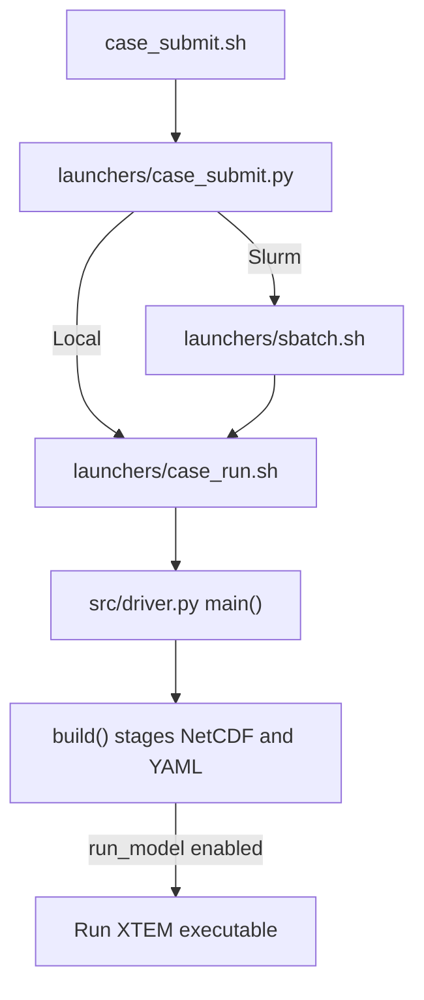

# TEM_UW_APP call hierarchy

| Stage | Calls and source files |
| --- | --- |
| Submit | [launchers/case_submit.py](launchers/case_submit.py) validates `run_config.yaml` and selects a local run or Slurm submission. [launchers/case_run.sh](launchers/case_run.sh) starts the Python driver in the case directory. |
| Stage inputs | `main()` in [src/driver.py](src/driver.py) calls `tem_config.load()` and `build()`. `climate()` calls [src/tem_climate.py](src/tem_climate.py) for unit conversion, time aggregation and spatial regridding. `merged()` and `regrid_file()` prepare the other grids. `save()` writes NetCDF, and `write_config()` writes `tem_config.yaml`. |
| Run TEM | `run()` starts the serial executable or `mpirun`. Model execution continues at `main()` in `src/driver/xtem_gds.cpp` in XTEM. See [the core call hierarchy](https://github.com/Lehigh-TEM-Felzer-Lab/XTEM/blob/main/flowchart.md). |
